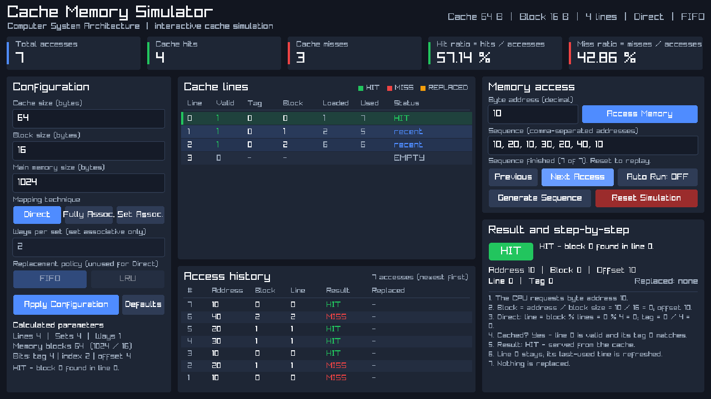
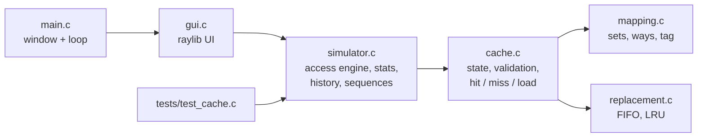
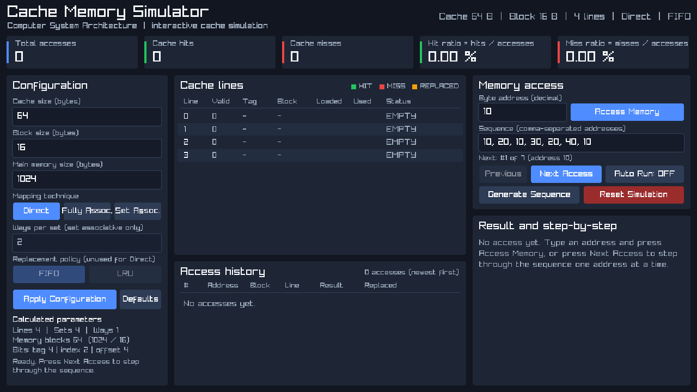
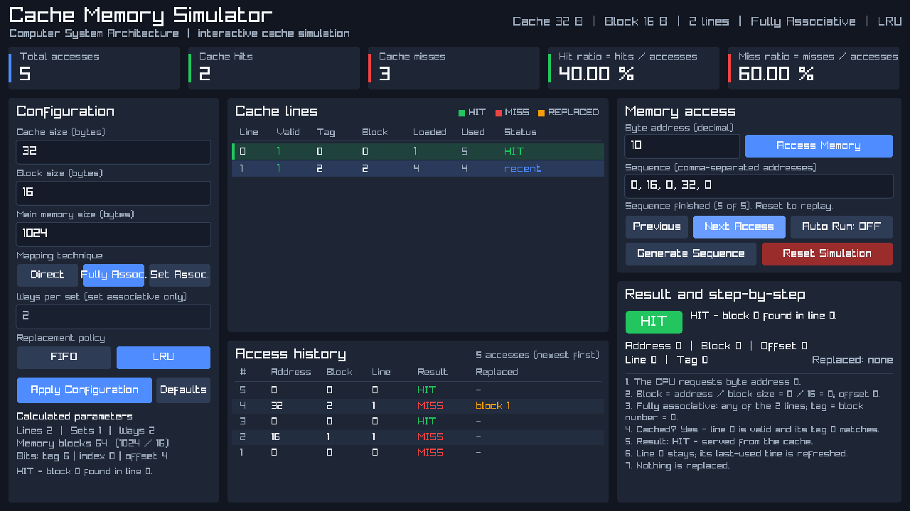
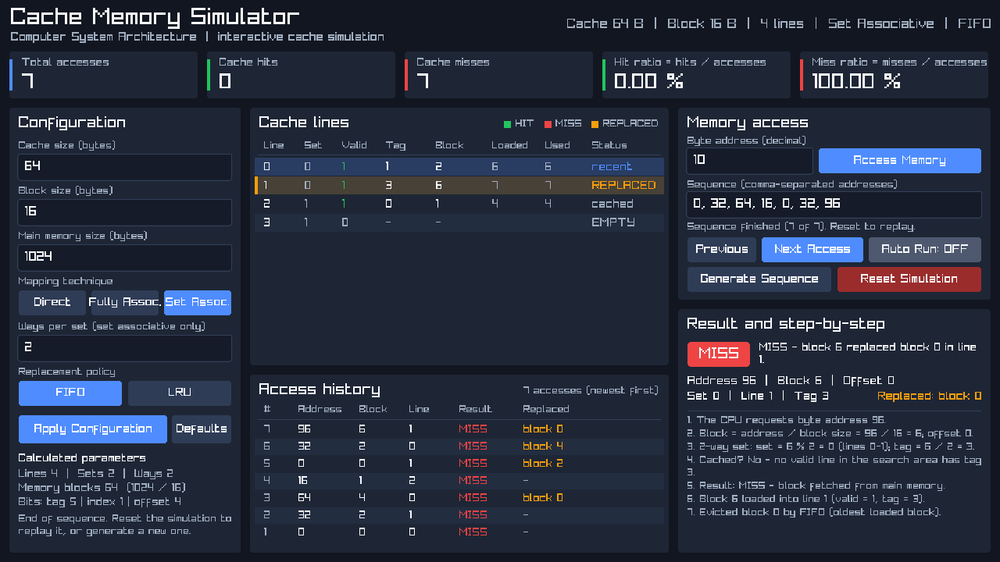

# Cache Memory Simulator

An interactive desktop simulator that shows, step by step, how a CPU cache
serves memory requests. Written in C11 with a [raylib](https://www.raylib.com/)
GUI for the Computer System Architecture (CSA) subject, MCA.



## 1. Introduction

A CPU is much faster than main memory, so a small, fast cache keeps recently
used blocks close to the processor. Whether a request is a **hit** (block already
cached) or a **miss** (block must be fetched, possibly evicting another block)
depends on the cache's *mapping technique* and *replacement policy*. This project
implements that logic for real and lets you watch it work.

## 2. Problem statement

Cache behaviour is hard to follow from formulas on paper. Students need a tool
that accepts memory addresses, applies the actual mapping and replacement rules,
and shows each hit, miss, line allocation and eviction together with the
arithmetic behind it.

## 3. Objectives

* Implement direct, fully associative and set-associative mapping correctly.
* Implement FIFO and LRU replacement independently.
* Provide a single, reusable memory-access routine that returns a structured result.
* Visualise the cache and statistics live; explain every access in seven steps.
* Keep logic and GUI separate, and verify the logic with automated tests.

## 4. Features

* Configurable cache size, block size, main-memory size, mapping, policy and ways.
  Every configuration is validated live; invalid ones cannot be applied, and the reason is shown.
* Calculated parameters shown automatically (lines, sets, ways, memory blocks, tag/index/offset bits).
* Live cache table: valid bit, tag, memory block, load time, last-used time, status.
  The selected line is highlighted (green = HIT, red = MISS, amber = REPLACED); recently used lines are tinted.
* Manual access (type an address) and sequence mode: **Next Access**, **Previous** (undo), **Auto Run**, **Generate Sequence**, **Reset Simulation**.
* Result panel with address, block, offset, set/line, tag, replaced block and the **7-step explanation**.
* Scrollable access history (newest first) and statistics with zero-division-safe ratios.

Keyboard: `Tab` moves between fields, `Enter` submits the address or loads the sequence, `Esc` leaves a field, mouse wheel scrolls the tables.

## 5. Technology stack

C11, raylib 5.5, MinGW-w64 GCC, GNU Make, VS Code, Git/GitHub. Windows 10/11 64-bit.
No other dependencies.

## 6. Architecture



Only `gui.c` and `main.c` include raylib, so the whole engine is testable without a window.
Details and the team ownership rules are in [docs/architecture.md](docs/architecture.md).

## 7. Directory structure

```
CacheSimulator/
├── include/   config.h  mapping.h  cache.h  replacement.h  simulator.h  gui.h
├── src/       main.c  gui.c  simulator.c  cache.c  mapping.c  replacement.c
├── tests/     test_cache.c
├── docs/      architecture.md  algorithms.md  viva.md  SETUP_WINDOWS.md  screenshots/
├── assets/    optional font (assets/font.ttf)
├── Makefile   config.mk.example   .gitignore   .gitattributes   LICENSE   README.md
```

## 8. Cache mapping

Byte address, memory block, cache line, tag and offset are different things:

```
block  = address / block size            offset = address % block size
set    = block % number of sets          tag    = block / number of sets
```

| Mapping | Sets | Ways | Where a block may go | Index | Tag |
|---|---|---|---|---|---|
| Direct | = lines | 1 | exactly one line | `block % lines` | `block / lines` |
| Fully associative | 1 | = lines | any line | none | `block` |
| Set associative | lines / ways | K | any line of one set | `block % sets` | `block / sets` |

Direct mapping is 1-way set-associative and fully associative is N-way with a
single set, so all three share **one** lookup/load routine (`cache_access`).
Example (64 B cache, 16 B blocks, 4 lines): address 100 → block 6, offset 4;
direct → line `6 % 4 = 2`, tag `6 / 4 = 1`.

## 9. FIFO and LRU

* **FIFO** evicts the block that was *loaded* earliest (`loadedAt`). A hit never changes `loadedAt`.
* **LRU** evicts the block whose latest use is oldest (`lastUsed`, refreshed on every hit and load).

A free line in the set is always used first; the policy is consulted only when the
set is full. In direct mapping each block has one possible line, so the policy has no choice
(the GUI greys the policy buttons out).
Example, 2-line cache, blocks A, B, A, C, A: FIFO evicts A for C and then misses on A (1 hit);
LRU evicts B and hits on A (2 hits).

## 10. Installation

Follow [docs/SETUP_WINDOWS.md](docs/SETUP_WINDOWS.md): install a 64-bit MinGW-w64 GCC
(`gcc`, `mingw32-make`), download the raylib 5.5 Windows (MinGW-w64) package, and tell
the Makefile where raylib is. **No path is hard-coded.** Pick one:

```
setx RAYLIB_DIR "C:/raylib-5.5_win64_mingw-w64"      # environment variable (reopen terminal + VS Code)
copy config.mk.example config.mk                      # or edit this git-ignored file
mingw32-make RAYLIB_DIR=C:/path/to/raylib             # or pass it on the command line
```

`RAYLIB_DIR` must contain `include/raylib.h` and `lib/libraylib.a`.
If your layout differs, set `RAYLIB_INC` and `RAYLIB_LIB` instead.

## 11. Build

```
mingw32-make help      # show the detected configuration
mingw32-make           # build\CacheSimulator.exe  (-std=c11 -Wall -Wextra -Wpedantic -Wshadow)
mingw32-make clean
mingw32-make BUILD=release   # optimised, no console window (run "clean" first)
```

(Use `make` if your toolchain, e.g. w64devkit, calls it that.)

## 12. Execution

```
mingw32-make run       # or double-click build\CacheSimulator.exe
```

Quick demo: press **Next Access** seven times to run `10, 20, 10, 30, 20, 40, 10`
on the default direct-mapped cache and watch MISS, MISS, HIT, HIT, HIT, MISS, HIT
(4 hits, 3 misses, 57.14 % / 42.86 %).

## 13. Screenshots

| Start | Direct mapping, spec sequence |
|---|---|
|  |  |
| **Fully associative + LRU** | **2-way set associative + FIFO (Auto Run)** |
|  |  |

Screenshots were captured from the same sources built for Linux under a virtual
display, using raylib's built-in font. On Windows the app loads Segoe UI when it
finds `C:/Windows/Fonts/segoeui.ttf` (or `assets/font.ttf`), so text looks smoother.

## 14. Testing

```
mingw32-make test
```

`tests/test_cache.c` links only the logic modules (no raylib) and runs 441 checks:
configuration validation, address arithmetic, empty cache, the spec sequence under
direct and fully associative mapping, direct-mapping collisions, FIFO and LRU
order, set-associative behaviour, capacity boundaries, invalid addresses, reset,
undo, sequence parsing, statistics and explanations. Exit code 0 means all passed.
Test table and expected traces: [docs/algorithms.md](docs/algorithms.md).

## 15. Team contributions

| Member | Role | Files |
|---|---|---|
| Member 1 (name) | Cache engine | `cache.h/.c`, `config.h` |
| Member 2 (name) | Algorithms | `mapping.h/.c`, `replacement.h/.c` |
| Member 3 (name) | GUI | `gui.h/.c` |
| Member 4 (name) | Integration, tests, docs, GitHub | `simulator.h/.c`, `main.c`, `tests/`, `Makefile`, `docs/` |

## 16. Future scope

Write policies (write-through / write-back with dirty bits), multi-level caches
(L1/L2), average memory access time, miss classification (compulsory / capacity /
conflict), random and pseudo-LRU replacement, trace-file import, CSV export.

## Limitations

* Read accesses only; data values and write policies are not simulated.
* Maximum 64 cache lines, 1 MiB of memory, 128-address sequences and 1000 recorded accesses.
* Sizes need not be powers of two, but the tag/index/offset bit split is shown only when they are.
* A set-associative cache with 1 way behaves as direct mapping, and with all lines as one set as fully associative.

## Conclusion

The simulator applies the real mapping and replacement rules through one tested
access routine and presents each decision visually, which makes cache behaviour
easy to demonstrate and to verify by hand.

## License

MIT, see [LICENSE](LICENSE).
