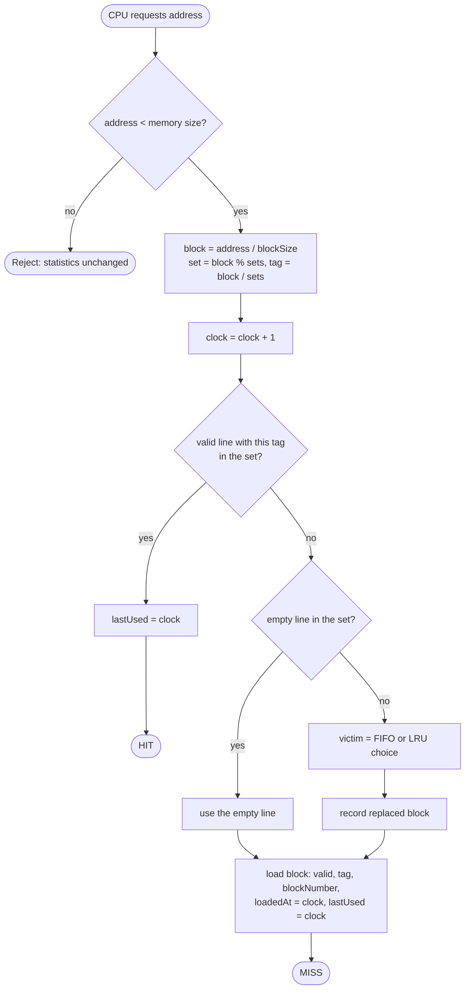

# Algorithms, Test Cases and Expected Outputs

Everything below matches the code in `src/cache.c`, `src/mapping.c`,
`src/replacement.c` and `src/simulator.c`.

## 1. Address calculations (integer arithmetic only)

```
block  = address / blockSize        offset = address % blockSize
lines  = cacheSize / blockSize      sets   = lines / ways
set    = block % sets               tag    = block / sets
first line of a set = set * ways    (the set occupies lines first .. first + ways - 1)
```

| Mapping | ways | sets |
|---|---|---|
| Direct | 1 | lines |
| Fully associative | lines | 1 |
| Set associative | user value (must divide lines) | lines / ways |

## 2. Cache access flowchart



## 3. Pseudocode

```
cache_access(cache, address):
    if address >= memorySize: return ERROR_OUT_OF_RANGE
    block, offset, set, tag = decompose(address)
    clock += 1
    S = lines[set*ways .. set*ways + ways - 1]
    for each line in S:
        if line.valid and line.tag == tag:          # HIT
            line.lastUsed = clock
            return HIT(line)
    line = first line in S that is not valid          # MISS
    if none:
        line = choose_victim(policy, S)               # S is full
        replacedBlock = line.blockNumber
    line = { valid=1, tag, blockNumber=block, loadedAt=clock, lastUsed=clock }
    return MISS(line, replacedBlock)

fifo_victim(S):  return line with the smallest loadedAt     # hits never change loadedAt
lru_victim(S):   return line with the smallest lastUsed     # refreshed on every hit and load
```

The logical clock increases by one per accepted access, so timestamps are unique
and ties cannot occur. Statistics: `hit ratio = hits / accesses x 100`,
`miss ratio = misses / accesses x 100`, both 0 when there are no accesses.

## 4. Expected outputs

### 4.1 Spec sequence `10, 20, 10, 30, 20, 40, 10` (64 B cache, 16 B blocks, 4 lines)

Blocks are 0, 1, 0, 1, 1, 2, 0. Direct mapping and fully associative give the same trace.

| # | Address | Block | Line | Result | Cache after (line = block) |
|---|---|---|---|---|---|
| 1 | 10 | 0 | 0 | MISS | 0=B0 |
| 2 | 20 | 1 | 1 | MISS | 0=B0, 1=B1 |
| 3 | 10 | 0 | 0 | HIT | unchanged |
| 4 | 30 | 1 | 1 | HIT | unchanged |
| 5 | 20 | 1 | 1 | HIT | unchanged |
| 6 | 40 | 2 | 2 | MISS | 0=B0, 1=B1, 2=B2 |
| 7 | 10 | 0 | 0 | HIT | unchanged |

Totals: 7 accesses, **4 hits, 3 misses, hit ratio 57.14 %, miss ratio 42.86 %**. Line 3 stays empty.
(Tags: direct `block / 4` = 0 for all three blocks; fully associative tag = block number.)

### 4.2 FIFO versus LRU (fully associative, 2 lines, addresses `0, 16, 0, 32, 0` = blocks A, B, A, C, A)

| Access | FIFO | LRU |
|---|---|---|
| A | MISS | MISS |
| B | MISS | MISS |
| A | HIT (does not reorder FIFO) | HIT (A becomes most recent) |
| C | MISS, evicts A (loaded first) | MISS, evicts B (least recent) |
| A | MISS, evicts B | HIT |
| **Hits / misses** | **1 / 4** | **2 / 3** |

### 4.3 Direct-mapping collision (4 lines): addresses `0, 64, 0`

Blocks 0 and 4 share line 0: MISS, MISS (evicts block 0), MISS (evicts block 4).

### 4.4 Set associative, 2-way, 2 sets, FIFO: addresses `0, 32, 64, 16, 0, 32, 96`

Blocks 0, 2, 4, 1, 0, 2, 6; blocks 0, 2, 4, 6 all map to set 0, block 1 to set 1.
Result: 7 misses; evicted blocks: none, none, 0, none, 2, 4, 0. Block 1 (set 1) is never disturbed.

## 5. Automated test table (`tests/test_cache.c`, 441 checks)

| # | Test group | What is verified |
|---|---|---|
| 1 | Config validation | zero sizes, block > cache, non-divisible sizes, too many lines, memory too small / large / unaligned, bad ways (0, not a divisor, too large), bad enums, NULL; a rejected config leaves nothing allocated |
| 2 | Address arithmetic | block, offset, set, tag for direct, set-associative and fully associative |
| 3 | Empty cache | all lines invalid, zero statistics, no division by zero |
| 4 | Spec sequence, direct | each outcome, line and cache state; 4 hits, 3 misses, exact percentages |
| 5 | Spec sequence, fully associative | same trace, lines allocated in order, tag = block |
| 6 | Direct collisions | blocks 0 and 4 conflict, replaced block reported, other lines unaffected |
| 7 | FIFO order | hit does not reorder; evictions A then B |
| 8 | LRU order | hit refreshes recency; B evicted, A survives |
| 9 | Replacement functions | `fifo_victim` / `lru_victim` on a hand-built set |
| 10 | Set associative | search limited to one set, FIFO and LRU inside a set, other sets untouched |
| 11 | Capacity boundary | fill exactly to capacity without eviction, all hit, next block evicts |
| 12 | Invalid addresses | `memorySize` and `UINT32_MAX` rejected with no side effects; `memorySize - 1` accepted |
| 13 | Reset | cache, statistics, history and clock cleared; sequence kept; first access misses again |
| 14 | Previous access (undo) | replay restores exact state, including restoring an evicted block |
| 15 | Sequences | parse, errors (empty, syntax, range, too long), cursor follows undo, generation valid and reproducible |
| 16 | Explanations | seven steps, HIT / MISS wording, one step for a rejected address |

Extra verification performed on the engine: the suite was also run under
AddressSanitizer + UBSan (no errors, no leaks) and with three deliberately injected
bugs (FIFO using `lastUsed`, hits not refreshing recency, a wrong set-index formula);
all three were detected.

## 6. Limitations

See the README: read-only accesses, 64 lines / 1 MiB / 128-address sequences / 1000 recorded accesses.
