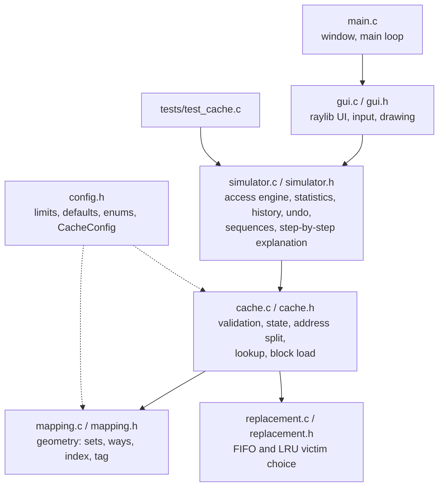

# Architecture and Team Plan

## 1. Layers and the one dependency rule



* A module may use only modules **below** it. Never the reverse.
* **Only `gui.c` and `main.c` include `raylib.h`.** Everything below `gui.c` is plain C,
  so the tests link it without a window.
* `gui.c` never does cache arithmetic. It sends user actions to the simulator and draws the
  structured `AccessResult` and `Explanation` it gets back.
* `replacement.h` includes `cache.h` only for the `CacheLine` type; `cache.c` calls
  `replacement.c`. There is no header cycle.

## 2. One engine for all three mappings

All mappings differ only in how many lines a block may occupy:

| Mapping | Sets | Ways | Index | Tag |
|---|---|---|---|---|
| Direct | N | 1 | `block % N` | `block / N` |
| Fully associative | 1 | N | none | `block` |
| Set associative | S | K (N = S x K) | `block % S` | `block / S` |

`cache_access()` searches the `ways` lines of one set, and the replacement policy picks a
victim inside that same set. The three mappings are therefore three values of
`(sets, ways)`, not three copies of the hit/miss/replace logic.

## 3. Key data structures

| Type | Header | Purpose |
|---|---|---|
| `CacheConfig` | `config.h` | user-chosen sizes, mapping, policy, ways |
| `CacheGeometry` | `mapping.h` | derived: total lines, ways, sets, memory blocks |
| `CacheLine` | `cache.h` | valid, tag, blockNumber, lastUsed, loadedAt |
| `Cache` | `cache.h` | config, geometry, heap-allocated lines, logical clock |
| `AccessResult` | `cache.h` | address, block, offset, set, tag, HIT/MISS, selected line, replaced block, message |
| `Simulator` | `simulator.h` | cache + statistics + history + sequence |
| `Explanation` | `simulator.h` | the seven step-by-step sentences |

Memory ownership: `cache_init` / `simulator_init` allocate; `cache_destroy` /
`simulator_destroy` free. Allocation results are checked, and a failed or rejected
initialisation leaves nothing allocated.

## 4. File ownership (one owner per file)

| Member | Role | Owns |
|---|---|---|
| 1 | Cache engine | `cache.h/.c`, `config.h` |
| 2 | Algorithms | `mapping.h/.c`, `replacement.h/.c` |
| 3 | GUI | `gui.h/.c` |
| 4 | Integration, tests, docs, GitHub | `simulator.h/.c`, `main.c`, `tests/`, `Makefile`, `docs/`, `README.md` |

A change to a file you do not own goes through its owner (GitHub issue or pull request comment).
Header changes need agreement from every module that includes them.

## 5. Git workflow

* `main` always builds and passes `mingw32-make test`. Nobody commits to it directly.
* Branches: `feature/m1-cache-engine`, `feature/m2-lru`, `feature/m3-dashboard`, ...
* Small commits with a module prefix: `cache: add direct-mapped lookup`.
* Every pull request is reviewed by another member; Member 4 merges.
* Before opening a pull request: `mingw32-make clean && mingw32-make && mingw32-make test`
  must finish with zero warnings and all tests passing.

First-time setup (one member):

```
git init
git add .
git commit -m "Initial project: cache engine, GUI, tests and docs"
git branch -M main
git remote add origin https://github.com/<user>/<repo>.git
git push -u origin main
```

## 6. Build rules

* The Makefile compiles every `src/*.c` automatically, so a new module needs no Makefile edit.
* Flags: `-std=c11 -Wall -Wextra -Wpedantic -Wshadow`. Warnings are bugs.
* `make test` compiles every `src/*.c` except `main.c` and `gui.c` together with `tests/test_cache.c`.
